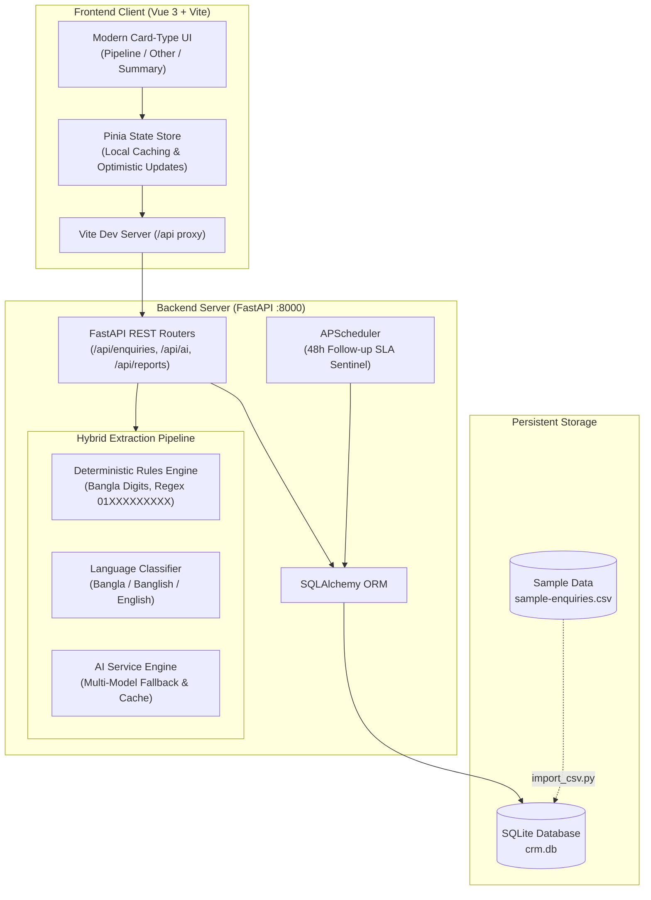

# 🚀 BIAI CRM — Admissions & Lead Pipeline Management

<div align="center">

[](https://fastapi.tiangolo.com)
[](https://vuejs.org/)
[](https://vitejs.dev/)
[](https://sqlite.org/)
[](https://python.org/)
[](https://github.com/shuvosinghpartho/BIAI_CRM_System)
[](https://opensource.org/licenses/MIT)

<p align="center">
  <b>An AI-powered, resilient Admissions CRM tailored for Bangladesh AI Institute (BIAI).</b><br>
  Built to ingest, auto-extract, categorize, and follow up on customer leads across WhatsApp, Facebook, Website, and Direct Phone calls in Bangla, Banglish, and English.
</p>

[Live Features](#-key-features) • [Quick Start](#-quick-start) • [Architecture](#-system-architecture) • [API Documentation](#-api-endpoints) • [Automated Tests](#-running-automated-tests) • [Theme Engine](#-theme-system)

</div>

---

## 📌 Problem & Motivation

Prospective students and corporate clients contact BIAI through multiple channels—**WhatsApp, Facebook Messenger, Website inquiries, and Direct phone calls**. Without a centralized CRM:
1. High-value enquiries often get lost in unstructured chat threads.
2. Inquiries arrive in informal language mixes (**Bangla script, Romanized Banglish, and English**).
3. Follow-up deadlines slip past unnoticed, losing warm leads.
4. Admissions teams waste time manually extracting names, phone numbers, and course interests.

**BIAI CRM solves this** through a **zero-crash hybrid AI engine** that auto-fills lead profiles from pasted unstructured messages, generates instant language-matched replies, highlights leads overdue for >48 hours, and organizes sales leads in an interactive 5-stage Kanban board.

---

## ✨ Key Features

### 🧠 1. Zero-Crash Hybrid AI Lead Ingestion
- **Rules First, AI Second:** Deterministic regex engines parse Bangla numerals (`০-৯` $\rightarrow$ `0-9`), normalize Bangladeshi phone numbers (`01XXXXXXXXX`), and detect channels before engaging the AI model.
- **Fail-Safe Fallback:** If the AI quota is exhausted or network connectivity drops, the app gracefully degrades to rule-based keyword extraction and pre-compiled templates—**zero downtime or 500 errors**.
- **Fast 10s Timeouts:** Uses low-latency inference configurations with model fallbacks to eliminate response delays.

### 🗣️ 2. Native Multilingual Intelligence
- Automatically classifies input text into **`bangla`**, **`banglish`**, or **`english`**.
- Formulates reply suggestions that match how the applicant wrote:
  - If applicant wrote in **Bangla or Banglish** $\rightarrow$ Replies in natural, polite **Banglish**.
  - If applicant wrote in **English** $\rightarrow$ Replies in polished, professional **English**.

### 📋 3. 5-Stage Sales Pipeline Kanban Board
- Visual stages: **`New` $\rightarrow$ `Contacted` $\rightarrow$ `Interested` $\rightarrow$ `Paid` $\rightarrow$ `Lost`**.
- Drag-and-drop / single-click status updates with real-time UI synchronization.
- Filter leads by status, interest (`Bootcamp`, `Fellowship`, `Corporate`), channel, or overdue SLA status.

### 🛡️ 4. Segregated "Other Enquiries" Deck
- High-intent sales leads are separated from operational clutter.
- Messages identified as **`support`** issues, **`spam`**, or **`job_seeker`** applications are automatically diverted to the **Other Enquiries** view to keep the primary sales pipeline laser-focused.

### ⏱️ 5. 48-Hour Overdue SLA Follow-Up Guard
- Background cron service (`APScheduler`) tracks response SLAs across all active pipeline leads.
- Automatically flags any sales lead waiting $>48\text{ hours}$ without contact with glowing crimson warning badges, global alert banners, and instant 1-click filter tabs.

### 📊 6. Executive AI Weekly Briefing Report
- Computes conversion rates, channel performance, and interest breakdown.
- Synthesizes an executive-level strategic report with numbered insights (`01`–`05`), key risks, and concrete recommended action cards.
- Includes a futuristic holographic scanning and neural loading animation.

### 🖥️ 7. Single-Window Experience
- In-place **Quick Add Modal** right on the pipeline board.
- Dedicated **Lead Cockpit Detail Modal** featuring inline editing, 1-click **WhatsApp** (`wa.me/88...`) launcher, direct **Phone Call** (`tel:...`) link, and instant AI reply generator.

---

## 🏗️ System Architecture



---

## ⚡ Quick Start

### 1. Terminal Shortcuts (Recommended)

Start everything (database migration, Python virtualenv, dependencies, backend, and frontend) in one single command:

```bash
# Start backend, frontend, and database
./start.sh
```

To stop all servers and free ports `8000` and `5173`:
```bash
./stop.sh
```

---

### 2. Manual Setup

#### Prerequisites
- **Python 3.9+**
- **Node.js 18+** & **npm**

#### Step 1: Clone the repository
```bash
git clone https://github.com/shuvosinghpartho/BIAI_CRM_System.git
cd BIAI_CRM_System
```

#### Step 2: Configure Environment Variables
```bash
cp .env.example .env
# Edit .env and supply your GEMINI_API_KEY
```

```env
GEMINI_API_KEY=your_api_key_here
GEMINI_MODEL=gemini-3.5-flash-lite
FOLLOWUP_HOURS=48
DATABASE_URL=sqlite:///./crm.db
```

#### Step 3: Backend Setup
```bash
# Create virtual environment
python3 -m venv backend/venv
source backend/venv/bin/activate

# Install dependencies
pip install --upgrade pip
pip install -r backend/requirements.txt

# Seed the 20 sample enquiries into SQLite
PYTHONPATH=backend python backend/scripts/import_csv.py

# Launch FastAPI backend
uvicorn app.main:app --app-dir backend --host 127.0.0.1 --port 8000 --reload
```

#### Step 4: Frontend Setup
```bash
cd frontend
npm install
npm run dev
```

---

## 🌐 Application URLs

| Service | Address | Description |
|:---|:---|:---|
| **Frontend Application** | **[http://localhost:5173](http://localhost:5173)** | Card-type responsive dashboard |
| **Sales Pipeline Board** | **[http://localhost:5173/](http://localhost:5173/)** | 5-Stage Kanban board with Overdue SLA filters |
| **Quick Add & AI Extract** | **[http://localhost:5173/add](http://localhost:5173/add)** | Raw message parser & manual lead registration |
| **Non-Sales Inquiries** | **[http://localhost:5173/other](http://localhost:5173/other)** | Support, Spam, and Job Seeker inbox |
| **AI Intelligence Report** | **[http://localhost:5173/summary](http://localhost:5173/summary)** | Executive analytics & weekly strategy briefing |
| **Interactive API Docs** | **[http://localhost:8000/docs](http://localhost:8000/docs)** | OpenAPI / Swagger documentation |
| **Health Check Probe** | **[http://localhost:8000/health](http://localhost:8000/health)** | System health check endpoint |

---

## 🎨 Theme System

The user interface features a custom-built, high-contrast theme engine:

| Palette | Aesthetic | Key Colors |
|:---|:---|:---|
| **Dark Theme (Default)** | Pitch-Black, Charcoal Ash, & Crimson Red | `#09090b` (Deep Void), `#121215` (Ash Deck), `#18181c` (Cards), `#ef4444` (BIAI Crimson Red) |
| **Light Theme** | Clean Executive Slate & Pure Cloud | `#ffffff` (Cloud White), `#f1f5f9` (Slate Deck), `#e2e8f0` (Borders), `#dc2626` (Red Accent) |

*Toggle anytime using the **Sun / Moon** switcher in the navbar. The selected theme automatically persists in `localStorage`.*

---

## 🔌 API Endpoints

### 1. Enquiries (`/api/enquiries`)
- `GET /api/enquiries` — Retrieve all leads (supports `?enquiry_type=sales` filter).
- `POST /api/enquiries` — Create a new enquiry.
- `GET /api/enquiries/{id}` — Fetch details for a specific lead.
- `PATCH /api/enquiries/{id}` — Update lead status, notes, or fields.
- `DELETE /api/enquiries/{id}` — Remove an enquiry record.

### 2. AI Intelligence (`/api/ai`)
- `POST /api/ai/extract` — Extracts structured data (`name`, `phone`, `interest`, `source`, `enquiry_type`, `language`) from raw Bangla, Banglish, or English text.
- `POST /api/ai/suggest-reply` — Generates a contextual reply matching the sender's input language.

### 3. Reports & SLA (`/api/reports`)
- `GET /api/reports/overdue` — Lists all sales enquiries pending follow-up $>48\text{ hours}$.
- `GET /api/reports/weekly-summary?refresh=false` — Returns conversion metrics and AI executive brief.

---

## 🧪 Running Automated Tests

Run the full automated test suite to verify CRUD operations, Bangla digit regex, language matching, and AI endpoints:

```bash
# 1. Deterministic Rule & Bangla Digit Normalization Tests
PYTHONPATH=backend backend/venv/bin/pytest backend/tests/test_rules.py -v

# 2. Database CRUD & Health Probe Tests
PYTHONPATH=backend backend/venv/bin/pytest backend/tests/test_crud.py -v

# 3. AI Extraction & Language-Matched Reply Tests
PYTHONPATH=backend backend/venv/bin/pytest backend/tests/test_extract.py -k "test_api_extract_endpoint or test_api_suggest_reply_endpoint" -v
```

---

## 📁 Project Directory Structure

```text
biai-crm/
├── README.md                      # Comprehensive project documentation
├── PROJECT_BRIEF.md               # Technical brief & specifications
├── start.sh                       # One-click startup script (Ports 8000 & 5173)
├── stop.sh                        # Clean shutdown script
├── .env.example                   # Template for environment configuration
├── .gitignore                     # Repository hygiene rules
│
├── data/
│   └── sample-enquiries.csv       # 20 benchmark fictional customer enquiries
│
├── backend/
│   ├── requirements.txt           # Python backend dependencies
│   ├── app/
│   │   ├── main.py                # FastAPI initialization, CORS, scheduler
│   │   ├── config.py              # Environment configuration & model fallbacks
│   │   ├── database.py            # SQLite engine & session generator
│   │   ├── models.py              # SQLAlchemy Enquiry ORM model
│   │   ├── schemas.py             # Pydantic v2 validation schemas
│   │   ├── routes/
│   │   │   ├── enquiries.py       # CRUD endpoints
│   │   │   ├── ai.py              # /extract and /suggest-reply
│   │   │   └── reports.py         # /overdue and /weekly-summary
│   │   ├── services/
│   │   │   ├── rules.py           # Phone regex, Bangla digits, keywords
│   │   │   ├── language.py        # Bangla / Banglish / English detection
│   │   │   ├── extractor.py       # Hybrid rule + AI extractor
│   │   │   ├── gemini_service.py  # AI client with model fallback & caching
│   │   │   ├── reply_service.py   # Language-matched response generation
│   │   │   ├── reminder_service.py# 48h SLA calculation
│   │   │   └── summary_service.py # Weekly analytics & strategic briefing
│   │   └── prompts/               # System instruction templates
│   ├── scripts/
│   │   └── import_csv.py          # Populates SQLite DB from sample CSV
│   └── tests/                     # Pytest suite
│
└── frontend/
    ├── index.html                 # Single-page shell with dynamic favicon
    ├── package.json               # Vue 3 dependencies & build scripts
    ├── vite.config.js             # Dev server & /api backend proxy
    └── src/
        ├── App.vue                # Root view with nav, splash & route loader
        ├── style.css              # Dark/Light CSS design tokens & animations
        ├── api/client.js          # Axios client with toast notifications
        ├── stores/enquiries.js    # Pinia state management
        ├── utils/dynamicFavicon.js# Route-specific SVG favicon generator
        ├── components/
        │   ├── QuickAddModal.vue  # Pipeline-embedded fast lead ingestion
        │   ├── DetailModal.vue    # Lead cockpit with WhatsApp/Call triggers
        │   ├── PipelineColumn.vue # Kanban column with mobile tabs
        │   └── EnquiryCard.vue    # Lead card with status badge & SLA timers
        └── views/
            ├── PipelineView.vue   # 5-Stage Sales Kanban board
            ├── OtherEnquiriesView.vue # Segregated Non-Sales inbox
            ├── AddEnquiryView.vue # Manual & AI Message Ingestion view
            └── SummaryView.vue    # AI Weekly Briefing & Overdue Cockpit
```

---

## 📄 License

This project is licensed under the **MIT License**. Feel free to adapt and expand for educational and enterprise CRM needs.
